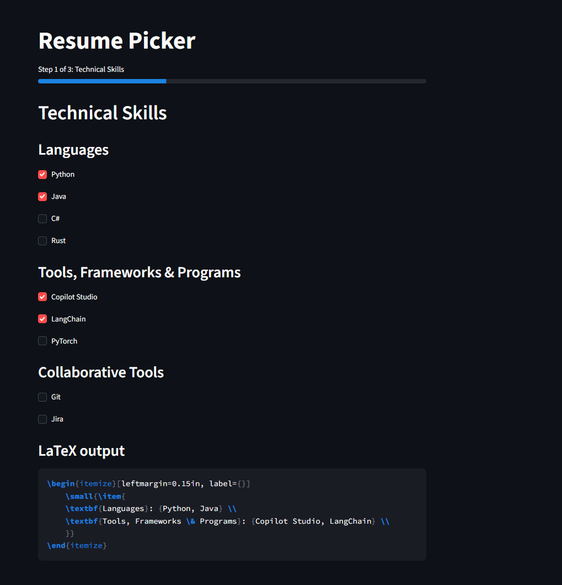
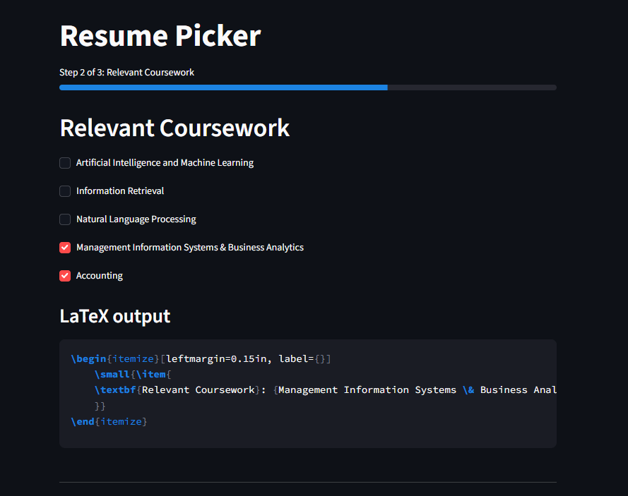
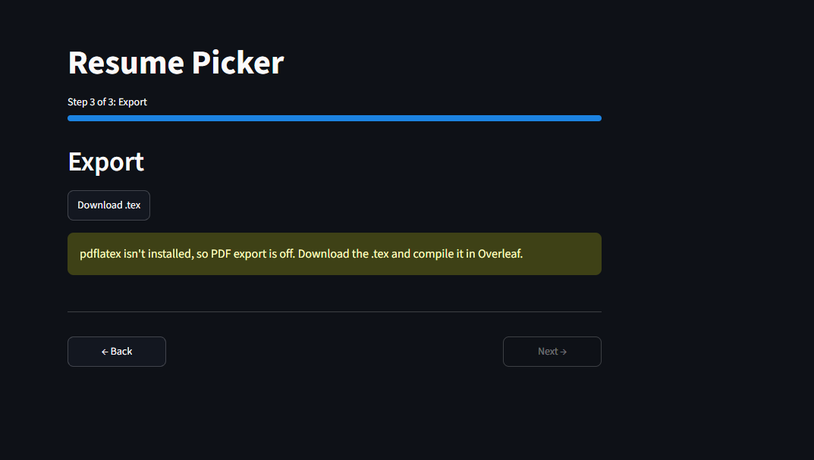
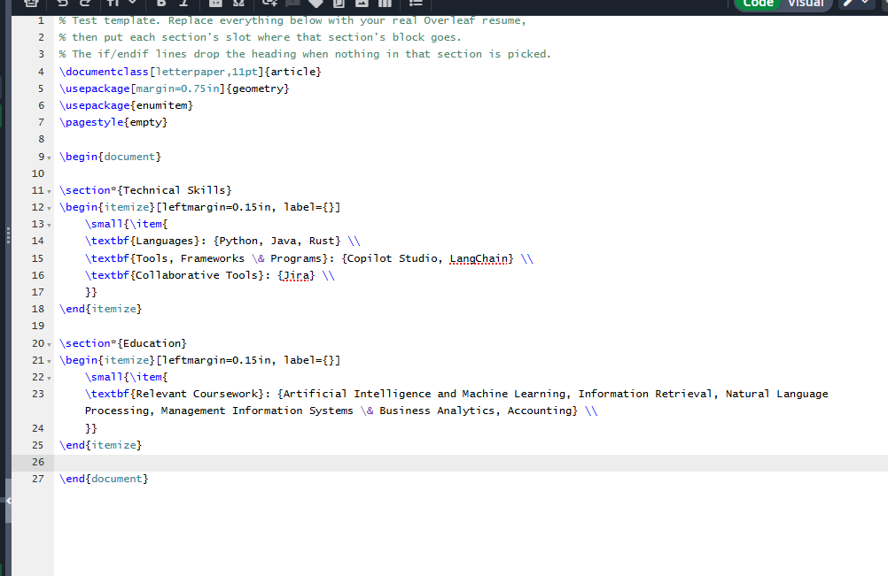
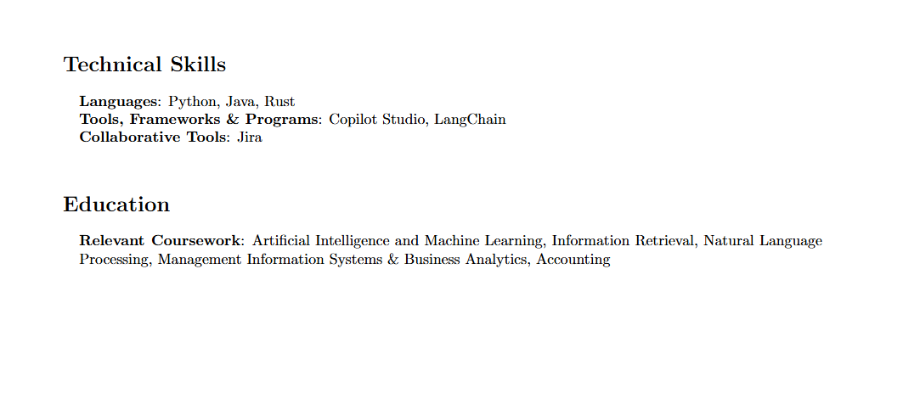
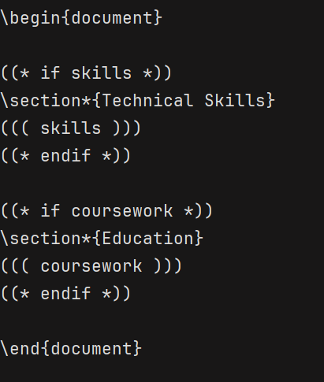
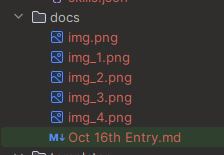

# Resume Wizard

- Making v1 at the moment, so far working nicely. Prototype built and in progress.
- Supposed to have certain categories, and within them, pages:
  - Technical skills
    - Languages
    - Tools, Frameworks & Programs
    - Collaborative Tools
  - Education
  - Experience
  - Personal Projects and Works
  - Collaborative Projects and Hackathons





And then I imported it to Overleaf. Looks nice.



- In the data folder, there would be 5 JSON files that carry the bulk of the info. You can also pick what to commit or not. Profile.json, for instance, is for things like your number, email, etc. Skills are arbitrary and shared with anyone, same for coursework. Experience and projects are also specific to you, so keep those files close.
```
data/
  profile.json
  skills.json
  coursework.json
  experience.json
  projects.json
```


## Learning about Jinja2 files
- Called a Jinja2 file, having placeholders for the data.
- ((( coursework ))) is a blank that gets replaced with your checked courses.
- ((* if skills *)) … ((* endif *)) means “only include this part if skills has something in it.”



## Things to Note
- Definitely use a dummy version if you make it public, like an example fallback.
- Also make sure to dump images in the right folder. I may make a folder per entry so it's cleaner.

  

- May need to put a requirements file or something.
- Ideas -> Make an application tracker for it, perhaps saving your configs for a certain resume and letting you track whether you've submitted it or not.
- Will name it something to do with Wizard, some stupid pun with Wizards on it
- "Pay no attention to the Latex behind the curtain"

## Next Steps
- Prob improve the template. Looks like trash, and add the other json catygories, adn put the 3 json in some env